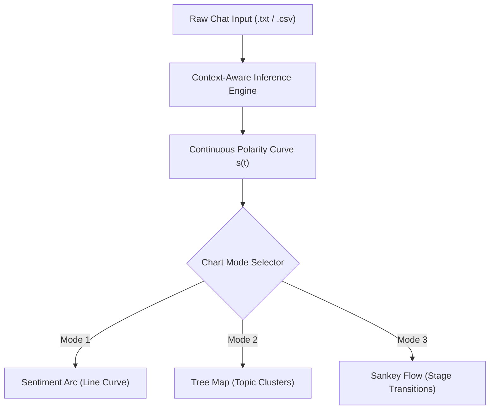

# Sentient Analysis — UI & Interaction Design Specification

An exhaustive user interface, visual identity, and interaction design specification for **Sentient Analysis** across both **Desktop GUI** (Tkinter + Matplotlib) and **Mobile App** (Android WebView + HTML5 Canvas).

---

## 1. Visual Identity & Design System

### 1.1 Brand Assets
- **Application Name:** Sentient Analysis
- **App Icon & Logo:** Distinctive modern typography with stylized saffron-gold radial blossom mark on solid deep-obsidian background.
- **Platforms Supported:**
  - **Desktop:** Windows (Standalone Executable / Tkinter GUI)
  - **Mobile:** Android 5.0+ (Lollipop through Android 15 / Native APK)

### 1.2 Color Palette (Editorial Dark Theme)

| Token | Hex Value | Semantic Usage |
| :--- | :--- | :--- |
| `--bg-base` | `#111214` | Primary app canvas background (high-contrast, eye-comfort dark mode) |
| `--bg-card` | `#18191B` | Elevated panels, cards, chat bubbles, sidebar drawers |
| `--bg-inset` | `#232528` | Input controls, chart background canvases, active tab pills |
| `--border-subtle`| `#3D3E42` | Hairline card boundaries, dividers, table grid lines |
| `--accent-coral` | `#E07A5F` | Primary interactive buttons, key action highlights, turning point markers |
| `--accent-teal` | `#3D5A80` | Secondary controls, inactive pills, info alerts |
| `--sentiment-pos`| `#81B29A` | Positive sentiment indications, upward drift, growth metrics |
| `--sentiment-neu`| `#F2CC8F` | Neutral sentiment indications, baseline equilibrium |
| `--sentiment-neg`| `#E07A5F` | Negative sentiment indications, tension inflection points |
| `--text-main` | `#F8F6EF` | Primary headers, conversational text (warm off-white cream) |
| `--text-muted` | `#9E9A90` | Subtitles, metadata, timestamps, axis labels |

### 1.3 Typography Hierarchy

| Level | Desktop Spec | Mobile Spec | Usage |
| :--- | :--- | :--- | :--- |
| **Hero / H1** | 14pt Inter/Segoe UI Bold | `1.25rem` / 800 weight | Application header and screen titles |
| **Section / H2** | 12pt Inter/Segoe UI Bold | `1.05rem` / 700 weight | Card headers, chart container labels |
| **Subhead / H3** | 10pt Inter/Segoe UI Bold | `0.95rem` / 600 weight | Tab titles, metric subtitles |
| **Body / Text** | 10pt Regular (26px row height) | `0.88rem` / 1.55 line-height | Chat transcripts, explanations, guide text |
| **Badges / Tags** | 8pt Semi-Bold | `0.72rem` / 700 uppercase | Polarity chips, Ad tags, status indicators |

---

## 2. Layman Accessibility & Simplified UX

To eliminate academic and scientific gatekeeping, all complex natural language processing (NLP) terminology is converted into intuitive everyday concepts:

| Academic / Statistical Term | Layman-Friendly Label | Intuitive Description |
| :--- | :--- | :--- |
| **Mean Polarity ($s_t$)** | **Average Mood 😊** | Whether the overall conversation feels positive, neutral, or upset |
| **Net Trajectory Drift ($\Delta$)** | **Overall Shift ↗** | Did the conversation get friendlier or more tense by the end? |
| **Trajectory Volatility ($\sigma$)** | **Mood Stability 🎯** | Whether emotions stayed calm or swung up and down erratically |
| **Candidate Turning Points ($|\Delta s| \ge \tau$)** | **Key Mood Shifts ⚡** | The exact moments when a participant's tone changed suddenly |
| **Context Window ($k$-turn)** | **Memory Depth 🧠** | How many previous messages the AI considers before judging tone |
| **Classification Confidence** | **AI Certainty 🔍** | How confident the AI is in its assessment (e.g., 94% certain) |

---

## 3. Desktop Application UI Architecture

### 3.1 Layout Wireframe

```
+---------------------------------------------------------------------------------------+
|  [Logo] Sentient Analysis  |  Model: RoBERTa Context-Aware  |  Status: Ready         |
+---------------------------------------------------------------------------------------+
|  SIDEBAR CONTROLS                |  MAIN CONTENT NOTEBOOK                              |
|                                  |  [ Visualizations ] [ Transcript ] [ Report ] [Export]|
|  1. Data Source Selection        |  +-------------------------------------------------+ |
|     [ Upload WhatsApp .txt ]     |  | Chart Selector: [Arc] [Tree Map] [Sankey]       | |
|     [ Load CSV / Dataset   ]     |  |                                                 | |
|                                  |  |  +-------------------------------------------+  | |
|  2. Analysis Parameters          |  |  |                                           |  | |
|     Memory Depth (k): [====|--] 3|  |  |            Matplotlib Canvas              |  | |
|     Shift Sensitivity: [==|---] 0.5|  |  |      (Interactive Visualizations)         |  | |
|                                  |  |  |                                           |  | |
|  3. Model Architecture           |  |  +-------------------------------------------+  | |
|     (o) RoBERTa Context-Aware    |  |                                                 | |
|     ( ) RoBERTa Independent      |  |  Summary: "Emotional Journey: Rags to Riches"   | |
|     ( ) TF-IDF Baseline          |  |  Turning Points Detected: 2 significant shifts  | |
|                                  |  +-------------------------------------------------+ |
|  [ RUN COMPREHENSIVE ANALYSIS ]  |  [Sponsor: 100% On-Device Private & Local AI]      | |
+---------------------------------------------------------------------------------------+
```

### 3.2 Key Components
1. **Header Ribbon:**
   - App branding icon and title.
   - Status badge reflecting engine readiness (idle, computing embeddings, rendering).
2. **Left Control Drawer:**
   - One-click WhatsApp `.txt` file ingest (automatically detects 12hr/24hr formats and brackets/dashes).
   - Sliders for contextual history depth ($k \in [1, 5]$) and inflection threshold ($\tau \in [0.2, 0.8]$).
   - Deep model selector radio group.
3. **Interactive Workspace (4 Tabs):**
   - **Tab 1: Visualizations & Dynamics:** Real-time Matplotlib interactive canvas supporting Sentiment Arc, Tree Map, and Sankey Diagram with instant switching pills.
   - **Tab 2: Utterance Data Grid:** High-contrast `ttk.Treeview` with alternating row colors, color-coded sentiment badges, and confidence meters.
   - **Tab 3: Plain-English Report:** Dynamic natural language summary diagnosing emotional arc archetypes, escalation warnings, and key takeaways.
   - **Tab 4: Export & Documentation:** One-click generation of PNG chart figures, audit CSV files, and HTML summary reports.
4. **Sponsor / Trust Banner:**
   - In-app native banner educating users on 100% on-device data processing with zero cloud data retention.

---

## 4. Mobile Application UI Architecture (Android APK)

### 4.1 Mobile Wireframe

```
+------------------------------------+
|  (o) Sentient Analysis     [Ready] |
+------------------------------------+
|  Quick WhatsApp Chat Analysis      |
|  Understand tone & mood in 3 steps |
|                                    |
|  [  📁 Choose WhatsApp .txt File ] |
+------------------------------------+
|  MOOD SNAPSHOT                     |
|  +---------------+---------------+ |
|  | Average Mood  | Overall Shift | |
|  |   +0.42 😊    |   +0.31 ↗     | |
|  +---------------+---------------+ |
|  | Stability     | Mood Shifts   | |
|  |    92% 🎯     |    2 Shifts⚡ | |
|  +---------------+---------------+ |
+------------------------------------+
|  INTERACTIVE CHARTS                |
|  [ Sentiment Arc ] [Tree Map] [Flow]|
|  +-------------------------------+ |
|  |                               | |
|  |     HTML5 Canvas Visualizer   | |
|  |       (Touch Responsive)      | |
|  |                               | |
|  +-------------------------------+ |
|  Takeaway: "Conversation resolved  |
|  with positive mutual agreement"   |
+------------------------------------+
|  CONVERSATION TIMELINE             |
|  [10:14] Alice: "Can we talk?" [Neu|
|  [10:15] Bob: "Sure, what's up?"  |
|  [10:16] Alice: "Thank you so much!|
+------------------------------------+
|  [ Sponsored Ad Banner Container ] |
|  AdMob Banner (320x50 / Adaptive)  |
+------------------------------------+
|  Privacy Policy • DPDP • GDPR • COPPA
+------------------------------------+
```

### 4.2 Key Mobile Features
- **Direct WhatsApp Upload:** Overridden `WebChromeClient.onShowFileChooser()` connects the web view directly to the Android native storage file picker, supporting `.txt`, `text/plain`, and WhatsApp exported chats.
- **Instant Metric Strip:** 4 grid-based KPI cards rendered in clear typography with relatable emoji indicators.
- **Canvas Rendering Engine:** Custom high-DPI HTML5 Canvas implementation with touch coordinate inspection, anti-aliasing, and zero external chart library overhead (<62 KB APK total size).
- **AdMob Integration:** Dedicated `#adBannerContainer` positioned at the bottom of the feed with non-intrusive compliance styling.
- **Legal Compliance Bar:** Direct links to the in-app GDPR, CCPA, and DPDP 2023 privacy statement.

---

## 5. Chart & Visualization Engine Specifications



### 5.1 Visualization 1: Sentiment Arc (Emotional Journey)
- **Concept:** Line plot tracing sentiment polarity $s_t \in [-1.0, +1.0]$ across sequential conversation turns.
- **Visual Stylings:**
  - Smooth Bezier line with gradient fill beneath the curve (`#81B29A` positive green above zero; `#E07A5F` coral negative below zero).
  - Glowing circle nodes identifying candidate turning points ($|\Delta s_t| \ge 0.5$).
- **Story Archetype Diagnosis:**
  Automatically maps the conversation curve against Kurt Vonnegut's classic narrative shapes:
  - *Rags to Riches:* Continuous steady rise from low/tense tone to positive resolution.
  - *Tragedy / Fall:* Starts positively but experiences unrecovered emotional collapse.
  - *Cinderella:* Dip into conflict followed by triumphant mutual de-escalation.
  - *Icarus:* Rapid early enthusiasm followed by abrupt drop.

### 5.2 Visualization 2: Sentiment Tree Map (Topic Clusters)
- **Concept:** Group sentiment distributions by topic and frequency, using rectangle area to indicate volume.
- **Visual Stylings:**
  - Squarified 2D partition algorithm.
  - Primary partitions: **Positive Feedback**, **Neutral Inquiry**, and **Constructive/Negative Concern**.
  - Internal chips displaying message count, percentage share, and sample snippet.

### 5.3 Visualization 3: Sankey Diagram (Sentiment Flow)
- **Concept:** Illustrates how sentiment evolves across three phases of the conversation:
  $$\text{Opening Phase} \longrightarrow \text{Middle Discussion} \longrightarrow \text{Conclusion Phase}$$
- **Visual Stylings:**
  - Smooth ribbon flows indicating volume of messages transitioning between states (e.g., how many initially negative comments evolved into positive outcomes).
  - Ribbon thickness proportional to utterance count.

---

## 6. Cyber Law, Ethics, and Monetization Architecture

### 6.1 Ad Revenue & Monetization
1. **Mobile AdMob Integration:**
   - AdMob Adaptive Banner container (`320x50` / `300x250` smart banners).
   - Standardized `#adBannerContainer` with prominent `Ad` / `Sponsored` disclosure badge.
2. **Desktop Sponsorship Ribbon:**
   - Subtle in-app native sponsor strip highlighting enterprise features and on-device privacy security.

### 6.2 Global Cyber Law Compliance
- **100% Local In-Memory Processing:** No chat text is ever transmitted to remote servers. All RoBERTa embeddings, parsing, and canvas charts are computed on the client device.
- **GDPR / CCPA / CPRA / DPDP Act 2023 / COPPA:**
  - Clear user rights to access, rectify, and delete local caches.
  - Granular consent controls regarding ad network tracking identifiers.
  - Prohibition of automated profiling that produces legal effects without human review.

---

## 7. Responsive Breakpoint & Platform Matrix

| Viewport | Target Device | Navigation Mode | Chart Layout |
| :--- | :--- | :--- | :--- |
| **< 480px** | Mobile Phones (Android Portrait) | Single-column scroll with sticky top bar | Stacked canvas with touch selector pills |
| **480px - 900px** | Tablets / Foldables | Two-column responsive card grid | Side-by-side metric cards, full-width canvas |
| **> 900px** | Desktop Window (1200x800) | Sidebar control panel + tabbed notebook | Split control pane with expandable Matplotlib canvas |
